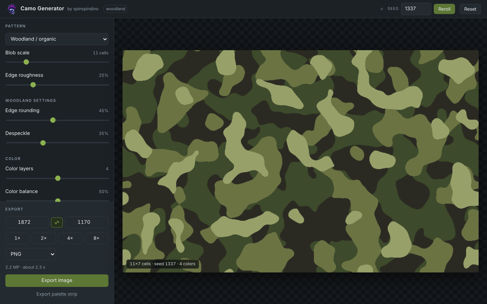

# Camo Generator

A parametric camouflage pattern generator that runs entirely in your browser. Pick a pattern style, drag the sliders, and watch the pattern update live. When you like it, export a seamless, tileable image at any size.

## Features

- **Four pattern engines**
  - **Woodland / organic**: classic blob camo, with edge rounding and despeckle cleanup
  - **Digital / pixelated**: blocky patterns that get finer at the edges of each shape
  - **Tiger stripe**: wandering parallel bands that taper and break up
  - **Geometric**: splinter shards, low-poly triangles, or a hex grid
- **Live preview**: draws at a lower resolution while you drag, then sharpens when you let go
- **Seamless tiling**: every export tiles perfectly, and a 2×2 preview lets you check it
- **Palettes**: six presets (woodland, desert, urban, winter, jungle, tiger), hand-picked colors, or colors pulled from a reference photo
- **Export**: PNG or JPG at up to 12000 px a side, plus a palette strip with hex codes
- **Reproducible**: every pattern comes from a seed number, so the same seed and settings always give the same pattern
- **Works on phones**: on a small screen the preview pins to the top while the controls scroll underneath

## Getting started

There is nothing to install or build. It is a single HTML file with no dependencies.

1. Download `index.html` (or clone this repo).
2. Open it in a modern browser (Chrome, Edge, Safari or Firefox).

It works offline, and you can also host it as a static page, for example with GitHub Pages.

## How to use it

1. Choose a pattern style under **Pattern**.
2. Shape it with the sliders. Settings that only apply to the current style appear in the middle group.
3. Pick a palette preset, click a color well to change a color, or use **Extract from photo…** to pull colors from an image.
4. Press **Reroll** for a new random variation, or type a seed to get one back.
5. Set the export size (the 1×/2×/4×/8× buttons match the preview's proportions) and press **Export image**.

### Keyboard shortcuts (desktop)

| Key | Action |
| --- | --- |
| `R` | Reroll the seed |
| `T` | Toggle the 2×2 tiling preview |
| `1` to `4` | Switch pattern style |
| Double-click a slider | Reset that slider |

On touch screens, tap a slider's green value to reset it.

### Tips

- A green value next to a slider means it has been changed from its default.
- The export panel estimates how long a render will take, based on how fast your device drew the last preview. Very large exports can freeze the page for a while, and phone browsers usually cannot handle more than about 12 megapixels.
- On iPhone and iPad, exports open the share sheet so you can save straight to Photos.

## Privacy

Everything happens on your device. The page makes no network requests, and photos you use for palette extraction never leave your browser.

## Terms of use

See [TERMS.md](TERMS.md). In short: what you make is yours, the tool comes with no warranty, and you are responsible for how you use the patterns.

## License

The source code is released under the [MIT License](LICENSE).
